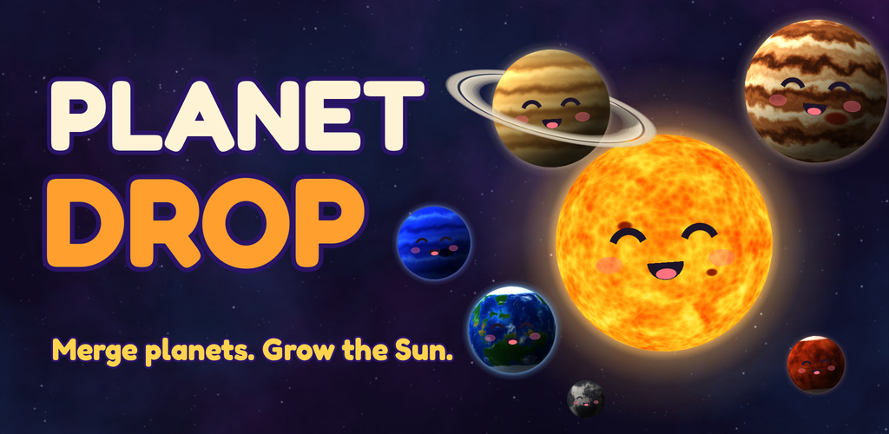

# Planet Drop

Drop cute planets into a jar, merge matching ones, and grow your way from a
tiny asteroid all the way to the Sun. A physics merge puzzle built with web
technology (TypeScript, WebGL, HTML/CSS) and packaged for Android with Capacitor.



## Features

- **Classic** endless mode, a **Daily Challenge**, and **Adventure**: 500
  levels in 25 chapters. Each chapter adds a mechanic (low gravity, rocks,
  stardust, clouds, frozen planets, shelves, marked planets, jelly bounce, ice,
  solar wind, spinners, gravity wells, heavy gravity, low ceiling, narrow jars)
  and the last chapters remix them, with goals, limited drops, stars and bosses
- **Puzzle levels** (about 85% of Adventure): you see every planet you'll get,
  in order, and each set-up is built around a trick (Over the Wall, Bank Shot,
  Keyhole, Missing Step, Ice Key, Small Steps, Sorting Machine...). Every
  puzzle ships with a solution found by a planning bot, and is rejected unless
  spamming (one spot, or random spots) fails; a video-ad hint shows the way.
  The rest are free-play levels: tutorial, each chapter's intro, breathers and
  the finale
- 11 planets, from Asteroid to Sun, modelled procedurally in Blender
  (`art/blender/`) and lit live in WebGL, so they can roll while the light
  stays put
- Box2D physics (planck.js), chain reactions with score multipliers, and a
  **Supernova** when two Suns merge
- Power-ups: **Black Hole** (remove a planet) and **Shake** (jolt the jar)
- **Daily Challenge** with the same drop sequence for everyone, plus streaks
- "Fair" drops that favour planets you can actually merge (like Block Blast's
  board-aware piece picker)
- 26 achievements that unlock 7 cosmetic jar styles
- Planet collection with fun facts, stats, and a first-run tutorial
- Ad-supported the Block Blast way: bottom banner in play, paced interstitials
  between games, and one optional rewarded "Keep going?" revive per run
  (see [docs/MONETISATION.md](docs/MONETISATION.md))
- Share your score, an occasional Play review prompt, and an opt-in daily
  reminder notification
- Your run is saved automatically and resumes after the app is closed
- Synthesized sound effects and ambient music (`art/audio/synth.py`)
- Haptics, safe-area support, Android back button, plays fully offline

## Quick start

```bash
npm install
npm run dev        # play at http://localhost:5173 (mouse: drag to aim, release to drop, Esc to pause)
```

## Project layout

| Path | What |
|---|---|
| `src/game/` | Rules and physics: world, jar, planets, effects |
| `src/render/` | WebGL planet lighting, 2D scene, faces, icons |
| `src/ui/` | HTML/CSS HUD and screens |
| `src/core/` | Save data, audio, haptics/back button, share/review/reminders |
| `src/monetization/` | AdMob placements and pacing |
| `src/meta/` | Achievements and jar styles |
| `public/assets/` | Planet textures, backdrop, audio, font (all generated, see below) |
| `android/` | Capacitor Android project |
| `tools/` | Playwright smoke test, screenshot capture, level simulator |
| `art/` | Sources that generate the assets (Blender, audio synth, store art) |
| `store/` | Play Store icon, feature graphic, screenshots and listing text |
| `docs/` | Publishing guide and privacy policy |
| `roblox/` | Roblox games (Luau + Rojo), see [roblox/README.md](roblox/README.md) |

## Testing

```bash
npm run build && npx vite preview --port 4173 &
npm test           # plays the game with touch input in headless Chrome
```

CI runs the same smoke test on every push before building Android.

Adventure levels are generated, then balanced by a bot that plays every level
with the real physics:

```bash
npx tsx tools/levelgen.ts         # build src/game/levels-data.json (seeded, repeatable)
npx tsx tools/puzzlegen.ts        # design the puzzle levels (planner + checks, ~30 min)
npx tsx tools/puzzlegen.ts --prune  # drop saved puzzles that random spam beats...
npx tsx tools/puzzlegen.ts 1 500 4 --refill  # ...and design replacements
npx tsx tools/calibrate.ts 1 500  # play each regular level, set its drop budget (~10 min)
npx tsx tools/verify-puzzles.ts   # replay every puzzle's stored solution (also run in CI)
npx tsx tools/spamcheck.ts 1 500  # how often spamming wins each level
npx tsx tools/storyboard.ts 150 sb.json && python art/tools/storyboard.py sb.json sb.png  # see a puzzle's solution
npx tsx tools/sim.ts 120 140 8    # spot-check: levels 120..140, 8 attempts each
```

## Android

GitHub Actions builds a signed `.aab` (for Google Play) and an `.apk` (for
your phone) on every push. See **[docs/PUBLISHING.md](docs/PUBLISHING.md)**.

To build locally you need Android Studio (or the Android SDK) and JDK 21:

```bash
npm run android:sync
cd android && ./gradlew bundleRelease
```

## Regenerating assets

```bash
pip install bpy pillow numpy scipy        # Blender as a Python module
python art/blender/planets.py             # planets + Saturn's rings
python art/blender/background.py          # nebula backdrop
python art/audio/synth.py                 # sound effects + music (needs ffmpeg)
```

Store screenshots are captured from the real game, then captioned:

```bash
npm run build && npx vite preview --port 4173 &
node tools/capture.mjs --scene=showcase --steps=showcase,merge --size=1080x1920@1 --out=shots
python art/tools/store_screens.py shots
```

Capture scenes: `title`, `showcase`, `supernova`, `powerups`, `pause`,
`resume`, `gameover`, `collection`, `settings`, `tutorial`, `autoplay`,
`map`, `intro`, `level`, `revive`, `complete`, `awards`
(add `?scene=<name>` to the game URL to watch one).
